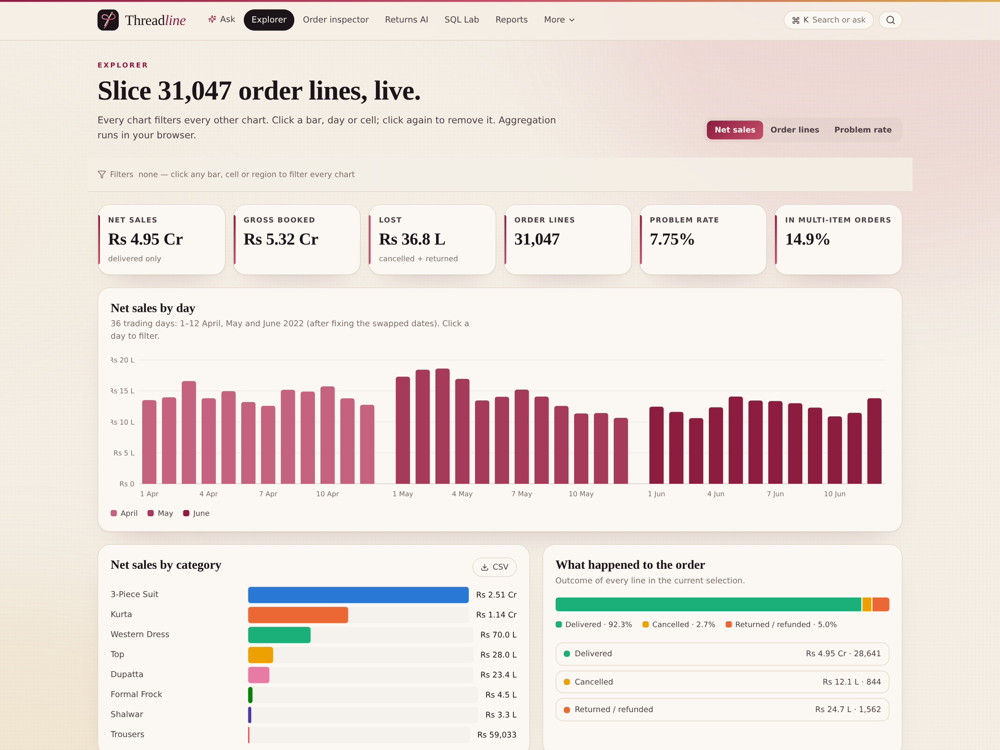
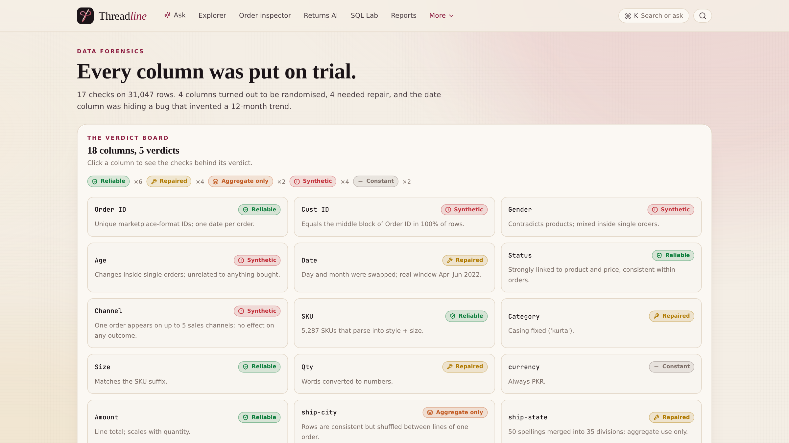
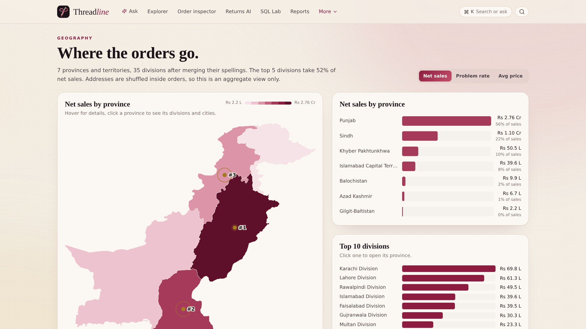
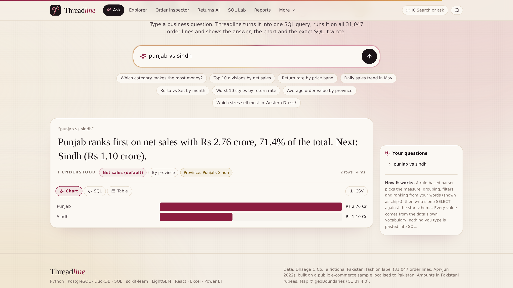
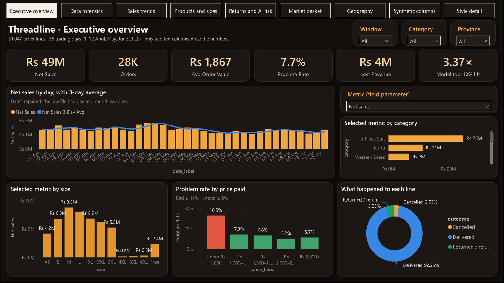
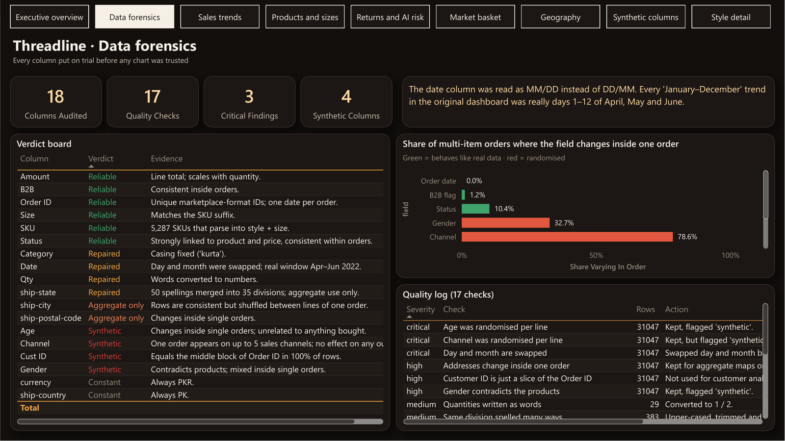
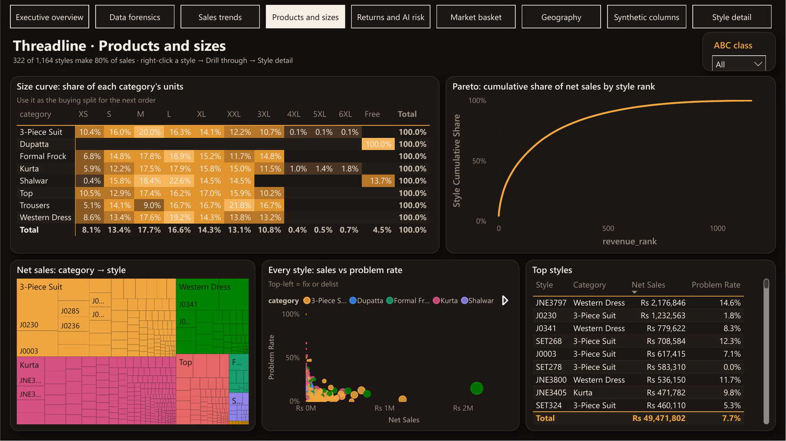
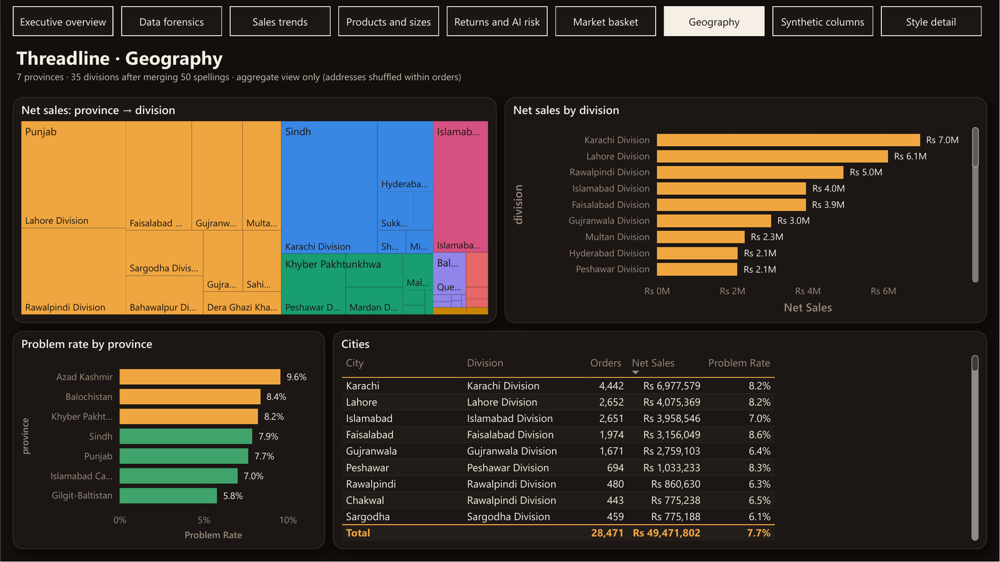
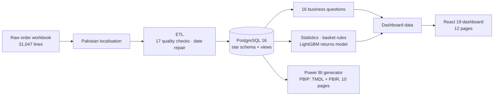

# Threadline

**Fashion e-commerce analytics that audits the data before trusting it.**
31,047 order lines of **Dhaaga & Co.**, a fictional Pakistani fashion label, rebuilt end to end: data forensics,
a PostgreSQL star schema, 16 business questions in SQL, statistics, a returns-prediction model,
an animated React dashboard and a 10-page Power BI report.

**Live:** https://threadline.twinstackstudio.com

## Screenshots

| React dashboard | | |
| --- | --- | --- |
|  |  |  |

| Power BI report | |
| --- | --- |
|  |  |
|  |  |

## Headline findings
- **4 of 18 columns were made up.** Channel, age, gender and customer ID were randomised by whoever built the file:
  79% of multi-item orders appear on 2+ sales channels at once (one Order ID, one date, up to 12 ages).
  A model using only those columns scores AUC 0.50 — a coin flip.
- **The "seasonal trend" was a date bug.** Day and month were swapped; the real window is 1–12 April, May and June 2022 (36 days).
- **322 of 1,164 styles (28%) make 80% of net sales.** 3-Piece Suits are half the business with the lowest problem rate.
- **Rs 36.8 L lost** to cancellations and returns (7.75% of lines). Items under Rs 1,000 fail 16.5% of the time vs ~6% above.
- **Returns model:** LightGBM AUC 0.735 (logistic 0.632); the riskiest 10% of lines fail 3.4× more often than average.
- **Basket:** multi-item orders are worth Rs 3,620 vs Rs 1,730; Shalwar + Dupatta has lift 8×.
- **Geography:** 7 provinces, 35 divisions; Punjab is 56% of net sales, Karachi, Lahore and Islamabad lead the cities.

## Stack
Python (pandas, SciPy, scikit-learn, LightGBM) · PostgreSQL 16 (star schema, views, window functions) ·
React 19 + Vite + Tailwind 4 + Framer Motion · Power BI (PBIP: TMDL model + PBIR report, generated from code)

## Architecture

## Source code

This is the public showcase. The source code is kept in a private repository. Try the live demo above, and [contact TwinStack Studio](https://twinstackstudio.com/contact) for a walkthrough or a similar project.

## Data and credits
Source: a public e-commerce sample workbook, localised to Pakistan by `pipeline/pakistan.py` (divisions, towns, postal codes,
sales channels, product names, PKR) before the audit runs; the mapping keeps the data's structure, so every finding still holds.
The store and its customers are fictional. Pakistan map: [geoBoundaries](https://www.geoboundaries.org) PAK ADM1 (CC BY 4.0).

© 2026 TwinStack Studio. All rights reserved. See [LICENSE](./LICENSE).
