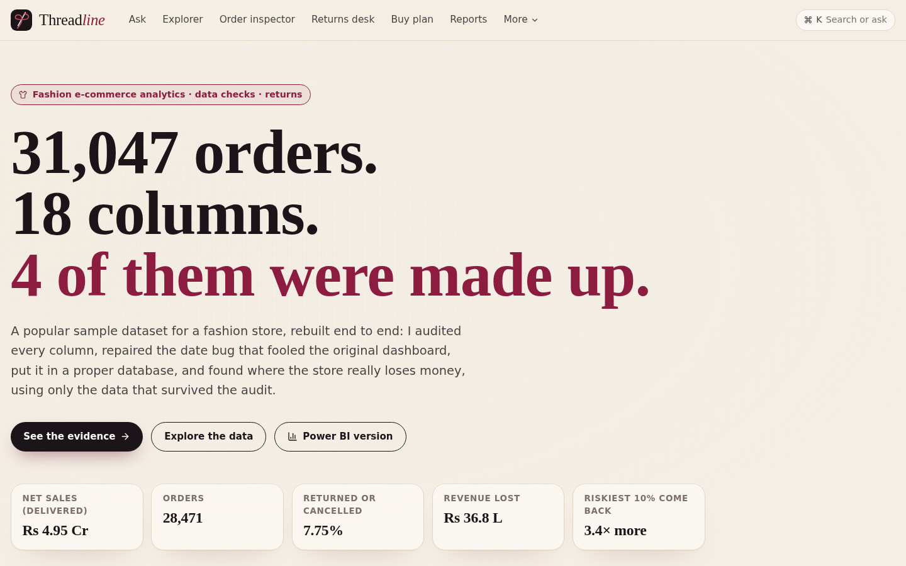
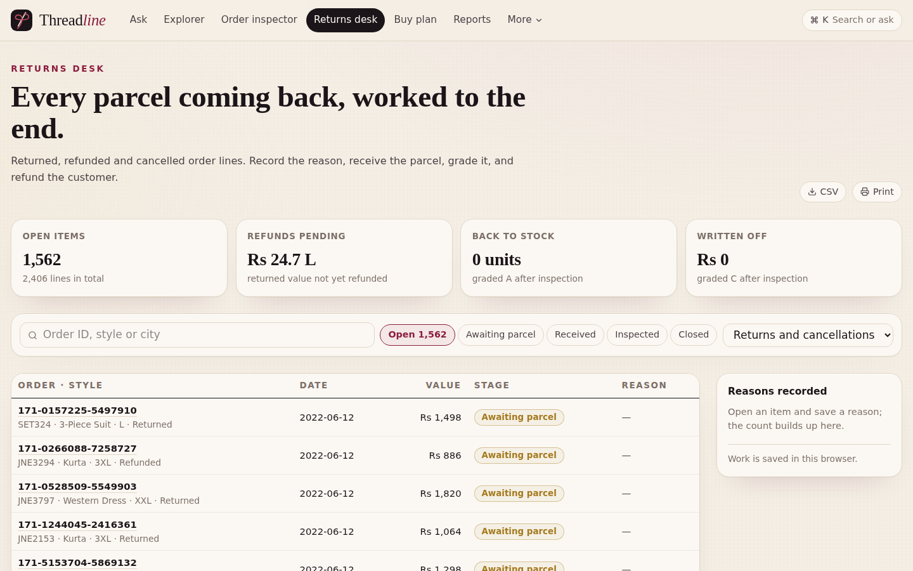
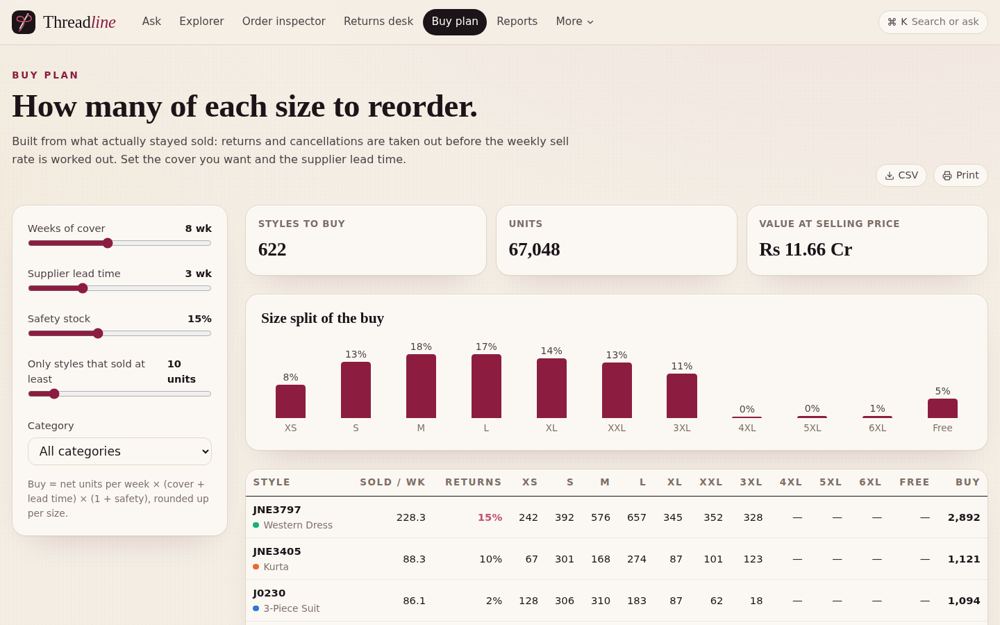
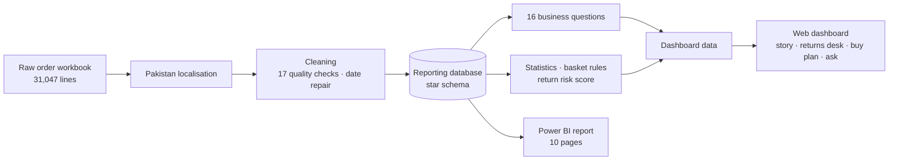

# Threadline

Fashion e-commerce analytics that audits the data before trusting it. 31,047 order lines of
**Dhaaga & Co.**, a fictional Pakistani fashion label, rebuilt end to end: data forensics, a
returns desk, a size-by-size buy plan, plain-language answers to any question, and a 10-page
Power BI report.

**Live:** https://threadline.twinstackstudio.com

## What it does

- **The story** — what the data really says, chapter by chapter, from the fake columns to
  where the money is lost.
- **Data forensics** — every one of the 18 columns put on trial: reliable, repaired,
  aggregate only or made up, with the evidence for each verdict.
- **Returns desk** — 2,406 returned, refunded and cancelled lines. Record the reason, mark
  the parcel received, grade it A/B/C back to stock or write-off, refund with a reference;
  every step has a history that can be undone. CSV export and print.
- **Buy plan** — how many of each style and size to reorder: net sell rate after returns,
  times weeks of cover plus supplier lead time, plus safety stock. Sliders, size split, CSV
  and print.
- **Ask** — type a business question in English, Urdu or Roman Urdu ("top 10 divisions by
  net sales", "punjab vs sindh"); Threadline looks it up across all orders and shows the
  answer, a chart, a short explanation in plain words and the exact query it ran.
- **Order inspector** — open any order, see every line and why it is risky.
- **Products, basket, geography, explorer** — the styles that make 80% of sales, items
  bought together, a Pakistan map by province and division, and a free explorer.
- **Reports** — an Excel workbook (12 sheets), a printable one-page brief, the Power BI
  files and the SQL behind every number.
- The layout and type scale from a 320 px phone to a 2560 px screen.

| Buy plan | Data forensics |
| --- | --- |
|  |  |

| Ask the data | Geography |
| --- | --- |
|  |  |

| Power BI report | |
| --- | --- |
|  |  |
|  |  |

## Headline findings

- **4 of 18 columns were made up.** Channel, age, gender and customer ID were randomised by
  whoever built the file: 79% of multi-item orders appear on 2+ sales channels at once (one
  order ID, one date, up to 12 ages). A score built only on those columns does no better
  than a coin flip.
- **The "seasonal trend" was a date bug.** Day and month were swapped; the real window is
  1–12 April, May and June 2022 (36 days).
- **322 of 1,164 styles (28%) make 80% of net sales.** 3-Piece Suits are half the business
  with the lowest problem rate.
- **Rs 36.8 L lost** to cancellations and returns (7.75% of lines). Items under Rs 1,000
  fail 16.5% of the time vs ~6% above.
- **Return risk:** the riskiest 10% of lines fail 3.4× more often than average.
- **Basket:** multi-item orders are worth Rs 3,620 vs Rs 1,730; Shalwar + Dupatta are bought
  together 8× more often than chance.
- **Geography:** 7 provinces, 35 divisions; Punjab is 56% of net sales; Karachi, Lahore and
  Islamabad lead the cities.

## Architecture

## Data and credits

Source: a public e-commerce sample workbook, localised to Pakistan (divisions, towns, postal
codes, sales channels, product names, PKR) before the audit runs; the mapping keeps the
data's structure, so every finding still holds. The store and its customers are fictional.
Returns desk notes are kept in the viewer's own browser. Pakistan map:
[geoBoundaries](https://www.geoboundaries.org) PAK ADM1 (CC BY 4.0).

## Source code

This is the public showcase. The source code is kept in a private repository. Try the live demo above, and [contact TwinStack Studio](https://twinstackstudio.com/contact) for a walkthrough or a similar project.

© 2026 TwinStack Studio. All rights reserved. See [LICENSE](./LICENSE).
